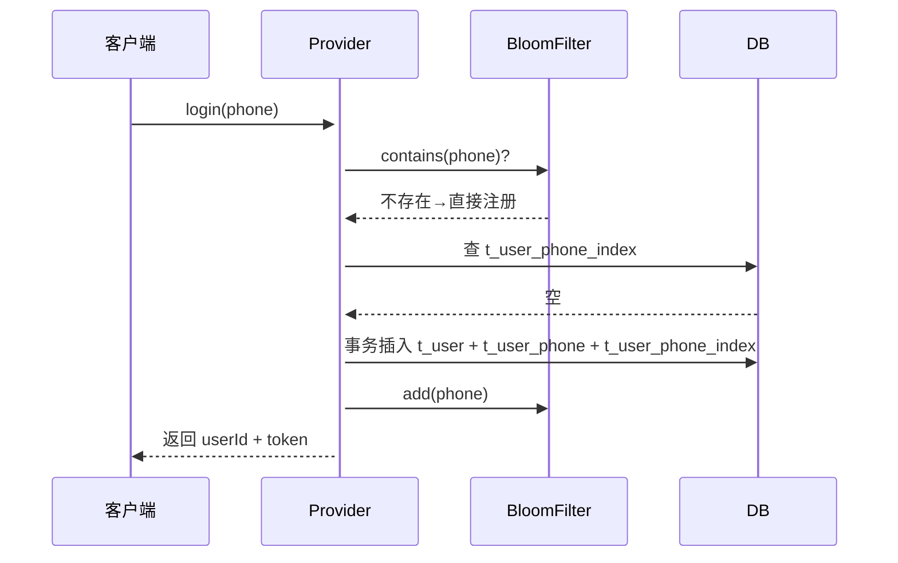
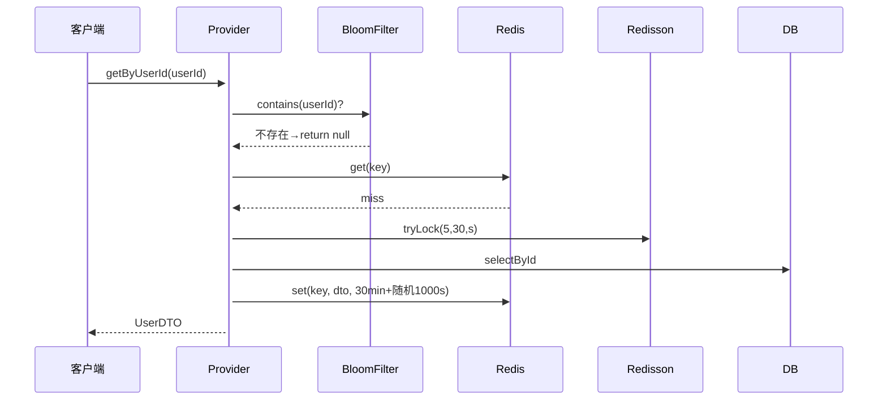
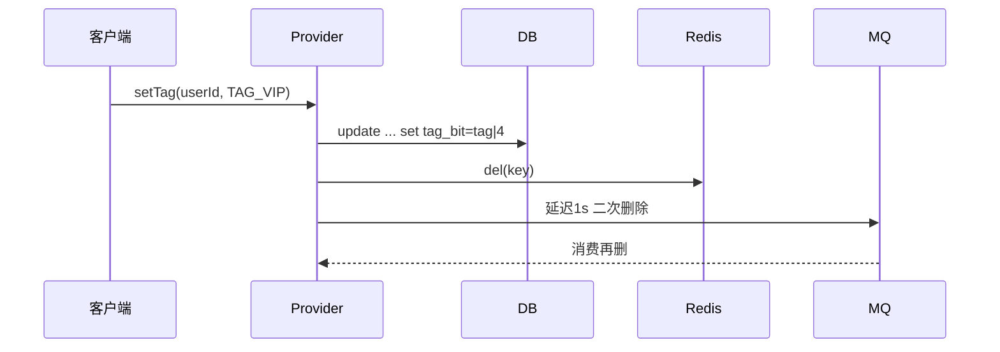

# 用户-provider 模块文档（live-user-provider）

> **所属模块**：`xy-live-user-provider` ｜ **上级索引**：[文档索引](../../docs/README.md) ｜ [项目 README](../../README.md)

## 1. 模块定位
提供**用户账号、手机号、标签**三大核心域的写读入口，兼顾
- 高并发读（Redis + 布隆过滤器 + 分布式锁）
- 秒级注册（手机号一键登录）
- 标签秒级生效（含延迟双删）

对外暴露 Dubbo RPC，对内强依赖 MySQL（分 100 表）、Redis、RocketMQ、Redisson。

## 2. 快速索引
| 场景 | 入口方法 | 关键类 |
|----|---------|--------|
| 手机号登录/注册 | `IUserPhoneService#login` | `IUserPhoneServiceImpl` |
| 查询用户基础信息 | `IUserService#getByUserId` | `IUserServiceImpl` |
| 打/取消标签 | `IUserTagService#setTag/cancelTag` | `IUserTagServiceImpl` |

## 3. 核心流程
### 3.1 手机号登录（注册⇋登录一体化）


### 3.2 读用户基础信息（缓存穿透/雪崩保护）


### 3.3 标签写（并发安全+延迟双删）


## 4. 类&方法详细说明

### 4.1 IUserPhoneServiceImpl
| 方法 | 主要逻辑 | 并发/缓存策略 | 异常 | 性能备注 |
|------|---------|--------------|------|---------|
| `login(String phone)` | 查 Bloom→命中则直接返回；未命中则注册并登录 | 注册过程无分布式锁，靠唯一索引兜底 | 任意异常包 `RuntimeException` | 注册链路 3 次 DB 写+1 次 MQ，RT ≈ 30-50 ms |
| `queryByPhone(String phone)` | Bloom→Redis→DB→Redis 回填 | 双重检查+Redisson 锁，防热点 Key 击穿 | 中断异常转 `RuntimeException` | 缓存命中 < 2 ms；锁等待 5 s 上限 |
| `queryByUserId(Long userId)` | 同上，Key 为 `phone:list:{userId}` | 列表缓存 30 min，穿透时填充空对象 30 s | - | 批量 100 条以内推荐 |

### 4.2 IUserServiceImpl
| 方法 | 主要逻辑 | 并发/缓存策略 | 异常 | 性能备注 |
|------|---------|--------------|------|---------|
| `getByUserId(Long userId)` | 单条查询，30 min+随机 TTL | Redisson 锁+双重检查 | 中断异常转 `RuntimeException` | 缓存命中率 95%+ |
| `batchQueryUserInfo(List<Long> userIdList)` | 先过滤 Bloom→Redis multiGet→分组并行查 DB→pipeline 回填 | 分 100 表并行，最多 100 线程 | - | 1 k 用户批量 RT ≈ 40 ms |
| `updateUserInfo(UserDTO)` | 更新 DB→删缓存→延迟消息二次删 | 延迟双删，解决并发读写不一致 | - | - |
| `insertOne(UserDTO)` | 写 DB+写索引表+Bloom add | 无锁，靠 DB 唯一索引 | - | - |

### 4.3 IUserTagServiceImpl
| 方法 | 主要逻辑 | 并发/缓存策略 | 异常 | 性能备注 |
|------|---------|--------------|------|---------|
| `setTag(Long, UserTagsEnum)` | update→行锁；影响行数=0 则 insert（分布式锁） | Redisson 锁 5 s，防并发 insert 重复 | 中断异常转 `RuntimeException` | 写 RT ≈ 10 ms |
| `cancelTag` | 置 0 & 删缓存 | 同 setTag | - | - |
| `containTag` | 先读 Redis，miss 再读 DB | 30 min TTL，无锁 | - | - |

## 5. 缓存 Key 规范
| 场景 | Key 模板 | TTL |
|------|---------|-----|
| 单条用户信息 | `user:info:{userId}` | 30 min + 0~1000 s 随机 |
| 用户手机号对象 | `user:phone:obj:{phone}` | 30 min |
| 用户手机号列表 | `user:phone:list:{userId}` | 30 min |
| 用户标签 | `user:tag:{userId}` | 30 min |
| 分布式锁 | `lock:user:phone:{phone}` / `lock:user:info:{userId}` / `lock:user:tag:{userId}` | 30 s 自动释放 |

## 6. 快速接入示例

### 6.1 手机号一键登录
```java
@DubboReference
private IUserPhoneService userPhoneService;

public String mockLogin(String phone){
    UserLoginDTO dto = userPhoneService.login(phone);
    if (dto == null) {
        throw new BizException("登录失败");
    }
    return JwtUtils.createToken(dto.getUserId());
}
```

### 6.2 批量查用户
```java
List<Long> userIds = Arrays.asList(10001L, 10002L);
Map<Long, UserDTO> map = userService.batchQueryUserInfo(userIds);
```

### 6.3 给用户打 VIP 标签
```java
boolean ok = userTagService.setTag(10001L, UserTagsEnum.VIP);
```

## 7. 运维& FAQ

**Q1: BloomFilter 初始化太慢？**  
A: 现采用 `@PostConstruct` 同步加载，建议改为“应用启动线程池异步 + 加载完成标志位”，防止阻塞首次请求。

**Q2: 缓存雪崩怎么办？**  
A: 所有过期时间都加了 `ThreadLocalRandom.nextLong(1000)` 秒抖动；若仍雪崩，可开启 Redisson 的 `trySetMulti` 原子写+随机 TTL。

**Q3: 手机号换了如何同步？**  
A: 目前只支持“新增手机索引”，不支持换绑。需新增 `changePhone` 接口，流程同注册，但要先校验旧手机验证码。

**Q4: 测试环境想清空 Bloom？**  
A: 执行 `redissonClient.getBloomFilter("user:phone:bloom:filter").delete()` 即可，下次 `@PostConstruct` 会重建。
