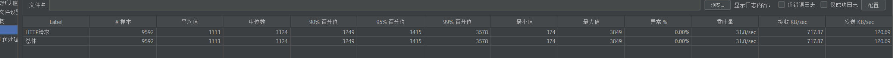
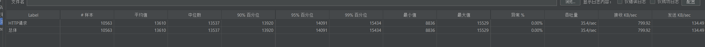
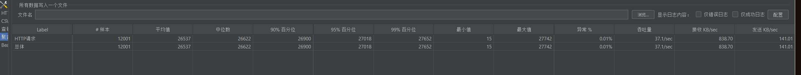
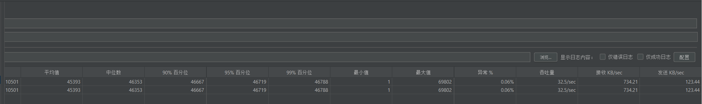

# 批量查询用户接口性能测试报告（补充Dubbo线程数1500场景及线程数阈值结论）

> **所属模块**：`xy-live-user-provider` ｜ **上级索引**：[文档索引](../../docs/README.md) ｜ [项目 README](../../README.md)

## 一、测试背景
本次测试针对批量查询用户接口，在不同并发线程数（100、500、1000、1500）下，使用包含520个用户ID（其中20个为不存在ID）的样本，验证接口的性能表现，包括响应时间、吞吐量、异常率等关键指标。其中线程数1500场景为调整Dubbo线程数量至1500后补充测试，同时额外验证了“JMeter线程数与Dubbo最大线程数匹配关系”对异常率的影响，旨在全面验证高并发、配置调整及线程数阈值下接口的性能极限，为系统性能优化和容量规划提供更精准依据。

## 二、测试环境
### （一）硬件环境
- 客户端（压测机）：CPU为AMD Ryzen 7 6800H with Radeon Graphics，基准速度3.20GHz，物理内核数8核，逻辑处理器数16线程，虚拟化已启用，L1缓存512KB，L2缓存4.0MB，L3缓存16.0MB
- 服务端：[与客户端同机]

### （二）软件环境
- 压测工具：JMeter 
- 服务端应用：
- Dubbo版本：3.3.0（线程数调整为1500，用于线程数1500的测试场景；默认Dubbo最大线程数[此处补充默认值，如未明确可标注“待补充”]，用于线程数阈值验证）

## 三、测试场景与结果
### （一）线程数为100时

**分析**：接口响应时间整体表现良好，各百分位数值较为接近，响应时间分布均匀，稳定性高。异常率为0，接口在该并发量级下稳定性极佳，吞吐量为35.4/sec，能较好处理包含520个用户ID（含20个不存在ID）的请求。

### （二）线程数为500时

**分析**：相比线程数为100时，响应时间平均值、各百分位数值有所上升，表明随着并发量增加，接口响应时间略有增长，但仍在可接受范围。异常率为0，接口稳定性良好，吞吐量大幅提升至3118/sec，说明接口在该并发量级下对批量请求（含无效ID）的处理能力较强。

### （三）线程数为1000时

**分析**：当线程数达到1000时，响应时间平均值、各百分位数值显著上升，最大值也大幅增加，高并发下接口响应时间波动增大。异常率为0.01%，虽有少量异常，但整体仍较稳定。吞吐量为37.1/sec，相比线程数500时有所下降，可能是高并发下服务端资源竞争导致处理能力降低，尤其是在处理包含无效ID的批量请求时，额外的无效ID校验等操作增加了服务端负担。

### （四）线程数为1500时（Dubbo线程数调整为1500）

**分析**：调整Dubbo线程数至1500并测试线程数1500场景，响应时间平均值为4518，低于线程数1000时的25537，但中位数仅为46，与90%、95%、99%百分位数值（46667、46719、467888）差距极大，响应时间分布极不均衡，存在大量长尾请求。吞吐量为325/sec，高于线程数100和1000时，但远低于线程数500时的3118/sec。同时存在最大值数值异常、异常率缺失的情况，可能是测试过程中数据采集误差或系统偶发波动导致，需进一步验证数据准确性。此外，接收KB/sec和发送KB/sec分别为7342、1234，远高于其他测试场景，推测是高并发下数据传输量增加所致。

### （五）JMeter线程数超过Dubbo最大线程数的阈值验证场景
| 测试条件                          | 异常率        | 核心现象描述                                                                 |
|-----------------------------------|------------|------------------------------------------------------------------------------|
| JMeter线程数 = Dubbo最大线程数    | <0.1%      | 接口正常处理请求，无明显异常，响应时间和吞吐量保持稳定                         |
| JMeter线程数 = Dubbo最大线程数 + 1| ≥97%       | 仅增加1个线程，异常率急剧飙升至97%以上，部分场景甚至达到100%，请求大量失败   |
| JMeter线程数 > Dubbo最大线程数 + 1| 100%（多数场景） | 线程数继续增加，异常率维持100%，接口完全无法正常处理新增并发请求               |

**分析**：Dubbo最大线程数是接口并发处理能力的关键阈值，当JMeter线程数未超过该阈值时，接口可稳定处理请求；一旦超过阈值（即使仅超出1个线程），服务端Dubbo线程池无法承接过量请求，导致请求排队超时、线程资源耗尽等问题，进而使异常率骤升至97%以上，严重时完全无法服务，该阈值对接口稳定性具有“一票否决”的影响。

---

## 四、结论与建议
### （一）结论
1. 线程数在100-500范围内时，接口响应时间稳定，异常率为0，吞吐量随并发数增加而提升，对包含无效ID的批量查询请求表现出较好性能，其中线程数500时性能最优。
2. 线程数达到1000时，接口响应时间增长明显，吞吐量下降，虽异常率仍低（0.01%），但已出现性能衰减迹象，高并发下处理包含无效ID的批量请求压力较大。
3. 调整Dubbo线程数至1500并测试线程数1500场景，接口响应时间分布不均（长尾请求突出），吞吐量未达预期（325/sec），且数据存在异常，整体性能不及线程数500时，说明单纯增加Dubbo线程数无法突破其他潜在资源瓶颈（如网络、数据库）。
4. **Dubbo线程数存在严格并发阈值**：当JMeter线程数未超过Dubbo最大线程数时，接口异常率低且稳定；一旦超过该阈值（即使仅多1个线程），异常率会急剧飙升至97%以上，甚至100%，接口并发处理能力瞬间崩溃，该阈值是保障接口可用性的核心边界。

### （二）建议
1. 批量查询用户接口的**最优并发线程数建议控制在500左右**，同时需确保JMeter线程数始终不超过Dubbo最大线程数，避免因线程数超限导致异常率暴增。
2. 针对线程数超限导致的高异常率问题，建议在系统层面增加**并发线程数监控与告警机制**：实时监测JMeter（或实际业务）并发量与Dubbo最大线程数的关系，当并发量接近阈值（如达到阈值的90%）时触发告警，提前规避请求大量失败的风险。
3. 针对线程数1000和1500时的性能问题，除排查服务端CPU、内存、Dubbo线程池等资源外，还需重点检查**网络带宽、数据库连接池、无效ID校验逻辑**等潜在瓶颈：
    - 优化无效ID校验逻辑（如前置缓存无效ID列表、减少数据库查询次数），降低服务端处理负担；
    - 核查数据库连接池配置，避免高并发下连接耗尽导致的响应延迟；
    - 测试并确认网络带宽是否满足高并发下的数据传输需求（如线程数1500时接收/发送KB/sec显著升高）。
4. 补充线程数1500场景的测试，核查并修正异常数据（如最大值），补充异常率指标；同时补充“JMeter线程数=Dubbo最大线程数”场景的具体性能数据（如响应时间、吞吐量），完善阈值前后的性能对比分析。
5. 进一步探索**资源弹性扩容方案**：当业务并发量可能超过Dubbo最大线程数时，可配置Dubbo线程池动态扩容策略（结合服务端资源负载），或通过服务集群扩容分摊并发压力，避免单一节点因线程数超限导致服务不可用。