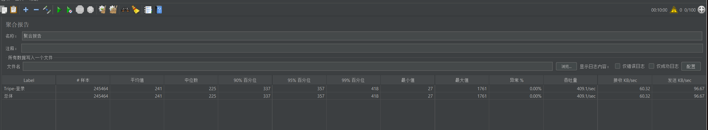
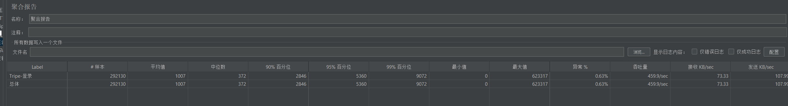

# 系统登录接口压测报告（100线程 & 500线程对比）

## 一、测试背景
为验证系统登录接口在不同并发压力下的性能表现，分别进行了**100个线程**和**500个线程**的压测，测试工具为 JMeter，核心观测指标包括响应时间、异常率、吞吐量等。

## 二、测试环境
| 环境项       | 详情                                                                 |
|--------------|----------------------------------------------------------------------|
| 压测工具     | JMeter 5.6.2                                                         |
| 压测机器     | 本地开发机（CPU：i7-12700H，内存：32GB，网络：千兆局域网）|
| 后端服务     | 测试环境（数据库：MySQL 8.0，缓存：Redis 6.2，应用服务器：Spring Boot） |
| 测试接口     | `/api/login`（用户手机号登录接口）|

## 三、测试结果对比
### （一）100线程压测结果
| 指标项         | 数值/说明                                                                 |
|----------------|--------------------------------------------------------------------------|
| 总请求数       | 245464 次                                                                |
| 平均响应时间   | 241 毫秒                                                                 |
| 90% 响应时间   | 337 毫秒                                                                 |
| 99% 响应时间   | 418 毫秒                                                                 |
| 异常率         | 0.00%（所有请求成功）|
| 吞吐量         | 409.1 次/秒                                                              |
| 数据传输       | 接收：60.32 KB/秒；发送：96.67 KB/秒                                     |

### （二）500线程压测结果
| 指标项         | 数值/说明                                                                 |
|----------------|--------------------------------------------------------------------------|
| 总请求数       | 292130 次                                                                |
| 平均响应时间   | 1007 毫秒                                                                |
| 90% 响应时间   | 2846 毫秒                                                                |
| 99% 响应时间   | 9072 毫秒                                                                |
| 异常率         | 0.63%（约 1840 个请求失败）|
| 吞吐量         | 459.9 次/秒                                                              |
| 数据传输       | 接收：73.33 KB/秒；发送：107.99 KB/秒                                    |

### （三） 1000线程+参数调整结果

## 四、结果分析
### （一）响应时间：压力增大，响应变慢
- 100线程下，平均响应时间仅 241 毫秒，99% 的请求在 418 毫秒内完成，响应速度快且稳定。
- 500线程下，平均响应时间增至 1007 毫秒（是100线程的 4 倍多），99% 响应时间达 9072 毫秒（约 9 秒），说明**并发压力增大后，系统处理单个请求的延迟显著增加**。

### （二）异常率：高并发下出现不稳定
- 100线程时，异常率为 0，所有请求均成功，系统稳定性极佳。
- 500线程时，异常率 0.63%，虽大部分请求仍成功，但存在约 1840 个请求失败，需排查失败原因（如数据库连接超时、Redis 缓存失效等）。

### （三）吞吐量：压力与处理能力的权衡
- 100线程吞吐量 409.1 次/秒，500线程吞吐量 459.9 次/秒，**吞吐量随并发数增加而提升**，说明系统整体处理能力有一定扩展性。
- 但结合响应时间和异常率，这种“吞吐量提升”是**以“响应变慢”和“部分请求失败”为代价**的，高并发下系统资源（如数据库连接池、CPU）已出现竞争。

## 五、优化建议
1. **高并发稳定性优化**：
    - 排查 500 线程下异常请求的失败原因（查看 JMeter “查看结果树”或后端日志），若为数据库连接超时，可调整数据库连接池大小（如增大 `maxActive` 参数）。
    - 优化 Redis 缓存策略，确保登录态（如 token）、热点数据（如用户信息）的缓存命中率，减少数据库穿透。

2. **响应时间优化**：
    - 对登录接口的 SQL 进行优化（如添加索引、简化查询逻辑），降低数据库查询延迟。
    - 若业务允许，可考虑异步处理非核心登录逻辑（如登录日志记录），减少同步请求的耗时。

3. **压测环境优化**：
    - 本地开发机资源有限（如 CPU、内存），高并发压测时易成为瓶颈。建议后续使用**分布式压测**（多台机器分担压力）或**测试环境服务器**进行更真实的压测。

## 六、总结
系统登录接口在 **100 线程低并发下性能优异（响应快、零异常）**，但在 **500 线程高并发下，响应延迟增加、出现少量异常**，需针对高并发场景进行稳定性和性能优化。